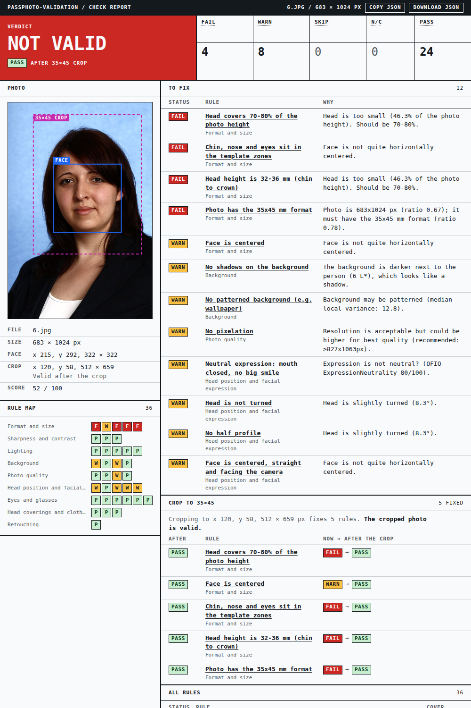
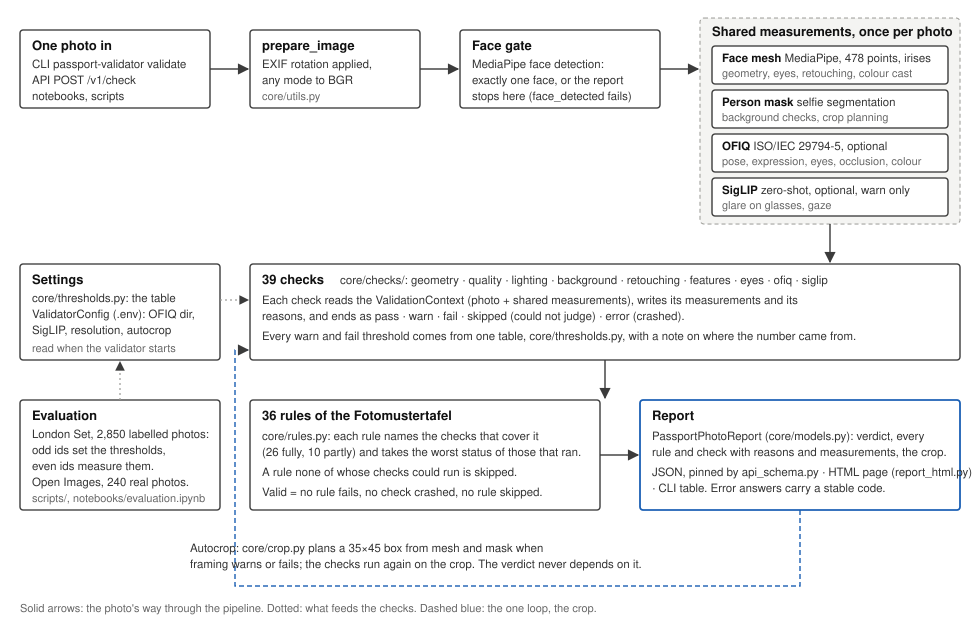

# passphoto-validation

Checks a photo against the German ID photo rules (the Fotomustertafel) and says which rules it passes, which it fails and why. 39 checks feed 36 rules. Most face measurements come from [OFIQ](https://github.com/BSI-OFIQ/OFIQ-Project), the BSI's implementation of ISO/IEC 29794-5, the rest from MediaPipe and OpenCV. The answer comes as JSON or as a self-contained HTML report, with a proposed 35×45 mm crop when the framing is off.



The Jupyter notebooks are the UI: `notebooks/pipeline_overview.ipynb` walks through the pipeline on the sample photos, `notebooks/evaluation.ipynb` shows how every check does on about 2,850 labelled photos and why the thresholds are where they are, `notebooks/stichprobe.ipynb` draws a random sample of those photos and shows each with its label and the validator's verdict, to check the claims by eye, `notebooks/api.ipynb` talks to the API. The architecture and the principles are below; [docs/architecture.md](docs/architecture.md) is the map with the files; [PASSPORT_VALIDATOR.md](PASSPORT_VALIDATOR.md) has the list of checks, the report format and the measured accuracy.

## Architecture



One photo goes through five stages (`src/passphoto_validation/core/validator.py`; the map with the files is [docs/architecture.md](docs/architecture.md)):

1. **In.** The CLI, the API and the notebooks hand the validator the same BGR array, EXIF rotation applied.
2. **The gate.** MediaPipe must find exactly one face, or the report stops here with every rule unjudged.
3. **Shared measurements**, once per photo: the face mesh (478 points), the person mask (selfie segmentation, with the hair and hats OFIQ's parsing labels joined), OFIQ's assessment (ISO/IEC 29794-5: pose, expression, eyes, occlusion, light, colour, background) and, when enabled, SigLIP's scores on the eye region.
4. **39 checks, 36 rules.** A check is a measurement with a unit and two levels; it ends as pass, warn, fail, skipped or error with its reasons and numbers. A rule takes the worst status of the checks that cover it; the checks that did not pass are grouped into problems, one per cause. Valid means no rule fails, no check crashed, no rule skipped.
5. **Out.** The report as JSON (pinned by `api_schema.py`), as one HTML page, or on the terminal, problems first. The one loop: when the framing is off, a 35×45 crop is planned and the checks run again on it; the verdict never depends on it.

A check is a small class, written the way a layer is in PyTorch: the class declares its parameters, an instance holds its values, `measure` does the work (`core/check.py`).

```python
class Contrast(Check):
    """Overall contrast: the standard deviation of the grey levels."""
    name = 'contrast'              # how reports, rules and thresholds files call it

    warn_below: float = 40.0       # the parameters: what the thresholds file can set
    fail_below: float = 30.0

    def measure(self, context):
        contrast = cv2.cvtColor(context.image_np, cv2.COLOR_BGR2GRAY).std()
        context.measurements['contrast'] = float(contrast)
        self.judge(context, contrast,
                   fail=(f'Contrast is far too low (grey-level spread {contrast:.0f}).', 7),
                   warn=(f'Low contrast (grey-level spread {contrast:.0f}).', 5))
```

The pipeline is one list of instances, `default_checks()` in `core/checks/__init__.py`, like `nn.Sequential`. Its order is the order of every report, and nothing is discovered or registered by import. Values are loaded onto it by check name, like a state dict: the table in `core/thresholds.py`, then the deployment's thresholds file.

```python
checks = Sequence(
    Resolution(), PhotoFormat(), FaceSize(), FaceCentered(), FaceSharpness(), Contrast(), ...,
    OfiqPose('ofiq_head_yaw', axis='yaw'),      # one class, several checks: the name belongs to the instance
    Gaze(), RedEyes(), ...,
)
validator = PassportPhotoValidator(checks=default_checks() + [MyCheck()])    # a check of your own joins the list
```

A check says what it depends on: `stops_after = ('ofiq_eyes_visible',)` means it is not run once the eyes are covered, `reads = ('face_sharpness',)` that it looks at that check's result and has to come after it. A check of your own is reported with the others and a fail of it makes the photo not valid; to decide a rule of the Fotomustertafel it is named under that rule in `core/rules.py`.

## Principles

1. **Every check is a measurement**: a number with a unit, a distribution on photos known to be good, and a threshold placed where that distribution ends. No check answers from a judgement it cannot show.
2. **Every check is configurable, nothing is hard-coded**: a warn level and a fail level, each one switchable off, the whole check switchable off, all from one file (`passport-validator thresholds`); the defaults live in one table that says where each number came from.
3. **Every verdict carries its evidence**: the check, the measurement, the threshold and the reason, grouped by cause, so a person can retake the photo and an operator can tune the check.
4. **A miss costs a card**: a photo that breaks a rule fails, because once it is printed the error is paid for in full; a false rejection costs a retake. The fail level sits where labelled defects are clearly past the line, the warn level where a measurement is borderline and a person should look, both chosen on one half of the data and reported on the other. The rate of good photos spared is reported as the price of that, never traded for catches. Two kinds of level are exceptions, and what is reported for them is not held-out: three were decided after a review of 100 photos of the reporting half on 2026-11-10 (stickers and low contrast fail instead of warning, head roll warns from 4° instead of 6°), and the colour-cast levels were placed on real candid photos, because the London Set fixes no level (its good crops measure 0, its casts 32 or more).
5. **A photo the pipeline could not judge is never valid**: a skipped rule blocks, a rule turned off on purpose does not.
6. **Names stay**: check names, rule ids and the keys of the report are what thresholds files, saved answers and API clients refer to, so they are never renamed or removed, only added to. The tests hold the list, so a rename fails loudly instead of breaking a client quietly.
7. **The photo never leaves the machine**: no third-party API in the pipeline, CPU only, about a second per photo. The baseline in `baseline/` is the one place a photo is sent out, for the comparison only.
8. **One command reproduces the numbers**: `./reproduce.sh`, from a clone to the evaluation table, with the photo sets fetched by script and never committed.

## Install

Linux on x86_64 (OFIQ's build script also knows arm64 Linux; not tried here). The OFIQ build needs git, Python 3 with venv, a C++ toolchain and unzip; the Python side needs [uv](https://docs.astral.sh/uv/). These are the only steps that need root:

```bash
sudo apt-get install git build-essential python3-venv unzip
```

```bash
curl -LsSf https://astral.sh/uv/install.sh | sh
```

Then clone and run the install script:

```bash
git clone --recursive git@github.com:simon-lund/passphoto-validation.git && cd passphoto-validation
```

```bash
./install.sh
```

The script

1. creates the Python environment (`uv sync --extra test`; Python 3.12 via `.python-version`, since MediaPipe has no wheels for newer versions),
2. fetches the OFIQ submodule, v1.2.1, into `third_party/OFIQ-Project` if the clone was not `--recursive` (set `OFIQ_PROJECT_DIR` to use a checkout elsewhere),
3. builds OFIQ and its Python wheel with its own conan and cmake inside that folder (untracked). This takes about 15 minutes and downloads OFIQ's models (430 MB) from eu-LISA. OFIQ's conan profile would install missing system packages with sudo; the script switches it to reporting them, so if the build stops with a list of packages, install those and run the script again,
4. installs the OFIQ wheel into the environment,
5. writes `OFIQ_CONFIG_DIR=…/third_party/OFIQ-Project/data` to `.env` (gitignored). The CLI, the API and the tests read it when started from the repo root; the notebooks look for `third_party/OFIQ-Project` themselves,
6. runs the validator once on a sample photo.

It is safe to run again, finished steps are skipped. Run it again after `git pull` as well: a plain `uv sync` removes the OFIQ wheel, `uv sync --inexact` (which the script uses) keeps it.

Options: `./install.sh --siglip` also installs the SigLIP second opinions on the eyes (PyTorch CPU; a 3.3 GB model downloads from Hugging Face on first use, to `HF_HOME`). `./install.sh --without-ofiq` skips OFIQ; the OFIQ checks then report `skipped`, the rules they cover end as `skipped`, and no photo is valid.

## Run

The CLI, with every check and its measurements:

```bash
uv run passport-validator validate tests/test-images/9.jpg -v
```

The API on http://127.0.0.1:9600 (docs at `/docs`); POST a photo to `/v1/check`, with `Accept: text/html` for the HTML report:

```bash
uv run passport-validator-api
```

The notebooks:

```bash
uv run --extra test jupyter lab notebooks/pipeline_overview.ipynb
```

The tests (the OFIQ ones run when `.env` points at OFIQ, otherwise they are skipped):

```bash
uv run --extra test pytest
```

## Thresholds

Every warn and fail threshold lives in one table, `src/passphoto_validation/core/thresholds.py`, each with a note on where the number came from. To run with other numbers without editing the code, write every parameter of every check to a file, keep the lines to change and pass the file back:

```bash
uv run passport-validator thresholds > thresholds.toml
```

```bash
uv run passport-validator validate tests/test-images/9.jpg --thresholds thresholds.toml
```

Every check has a warn level and a fail level (`warn_…`, `fail_…`); `false` turns a level off, and `enabled = false` turns a check off, so that the rule only it covered reports `not_checked`, which never blocks validity. So "stickers warn only", "stickers fail from 4 percent" or "no retouching rule at all" are each a line or two:

```toml
[skin_colour_patches]
fail_share_above = false

[skin_smoothing]
enabled = false
```

Without `--thresholds`, the CLI, the API and the review page all read the file `THRESHOLDS_FILE` names (in the environment or in `.env`); the CLI prints which file it runs with, and the API lists the values at `/v1/thresholds`. A file that names a check or a parameter that does not exist, or gives a wrong type or a list of the wrong length, stops the command or the server with a message, so a typo never silently keeps the default. A parameter that was renamed keeps answering to its old name, so a file written earlier still loads. The file is applied last, so its `[resolution]` values win over `MIN_RES_WIDTH` and the other resolution settings of the environment.

A few levels carry older names: `min_res` and `recommended_res` of `resolution`, `tolerance` of `photo_format`, `vertical_range` of `face_centered`. `false` turns those off the same way. One function grades every check (`core/levels.py`): the fail level holds whether or not the warn level is on, and a message never names a level that is off.

## Evaluation data

The labelled photo sets live in `data/`, which git ignores except for its README and the review answers (`data/README.md` lists every folder and how it is made). One script takes a clone to the numbers in `PASSPORT_VALIDATOR.md`: the install, the London download, the evaluation set, the pipeline over it, the report:

```bash
./reproduce.sh
```

The steps by hand: the [Face Research Lab London Set](https://doi.org/10.6084/m9.figshare.5047666) (102 people photographed on a grey backdrop, neutral and smiling, front and 3/4 views; CC BY 4.0, but its subjects consented to use in studies, so neither it nor anything made from it may be committed or redistributed) downloads in one step, and two more build and run the evaluation set: about 2,850 photos, the compliant crop of each person, their real smiling and 3/4-view photos, and 24 synthetic variants drawn into each compliant crop, 22 of which break exactly one rule and 2 of which (a 4° roll, clear glasses) must still pass. Even ids are the test half, odd ids the half the thresholds were set on.

```bash
uv run python scripts/download_london_set.py --out data/london
```

```bash
uv run python scripts/build_eval_set.py --source data/london --out data/london-eval
```

```bash
uv run python scripts/run_eval.py --set data/london-eval
```

For a quick set of test photos, `scripts/make_test_photos.py` takes any folder of frontal portraits (the London Set's `neutral_front`, or your own), crops each to a compliant photo and draws one defect into each copy, with a manifest that says which rule each photo breaks:

```bash
uv run python scripts/make_test_photos.py --source data/london/neutral_front --out data/test-photos --count 100
```

`notebooks/stichprobe.ipynb` draws a random sample from a set (`LONDON_SET` points it at one, by default the evaluation set), runs the validator on every sampled photo and shows it with its label and the verdict, so the numbers in the evaluation can be checked by eye.

To judge the verdicts one photo at a time, `scripts/review.py` serves a local page that shows each photo with what the pipeline saw drawn over it (person mask, face box, eyes, eye whites, OFIQ's landmarks and face parsing, the planned crop), the label, and the verdict with every rule that fails or warns and why. Press Y when the verdict is right, N when it is wrong, click a rule to mark that rule as wrong, add a comment; swipe on a touch screen. The answers go to `reviews.jsonl` next to the set, and `--summary` prints what they say per rule and per variant. `--split`, `--variant`, `--check NAME=STATUS` and `--rule ID=STATUS` narrow the queue to, say, the photos where a check warned:

```bash
uv run python scripts/review.py --set data/london-eval --split test --shuffle
```

```bash
uv run python scripts/review.py --set data/london-eval --check colour_cast=warn
```

The 240 real photos behind `notebooks/real_photos.ipynb` come from Open Images (Flickr, CC BY 2.0) and are built by `scripts/build_openimages_set.py` from Google's metadata; `credits.csv` next to them lists each photo's author and licence.

## The baseline

`baseline/` is the system the pipeline is measured against: the same 36 rules asked of OpenAI's Decisions API, one request per photo, with its own package, README and environment. It exists as proof of the comparison in the docs; the pipeline itself sends no photo anywhere. Its results sit next to the pipeline's in `data/london-eval/results_decisions.jsonl`.

## Licence

EUPL 1.2. The code started as a fork of eduTAP's `edutap.image_api` by Philipp Auersperg-Castell and Alexander Loechel (EUPL 1.2); the sample photos `tests/test-images/1.jpg` to `9.jpg` come from there.
