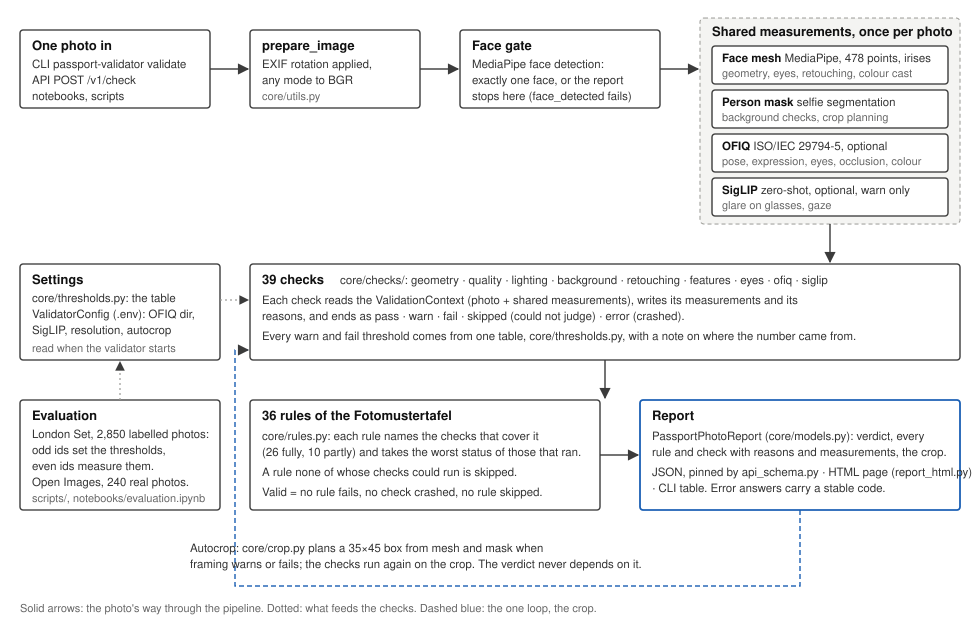

# Architecture overview

passphoto-validation takes one photo and answers, rule by rule, whether it meets the German ID photo rules (the Fotomustertafel) and why. The answer is built in five stages, each in its own module, and every number a verdict depends on lives in one table. This page is the map; [PASSPORT_VALIDATOR.md](../PASSPORT_VALIDATOR.md) has the detail per check, the report format and the measured accuracy.



## The five stages

1. **In.** The CLI (`passport-validator validate`), the API (`POST /v1/check`) and the notebooks all hand the validator the same thing: a BGR array from `prepare_image`, which applies the EXIF rotation and converts any image mode. The validator itself (`core/validator.py`) knows nothing about HTTP or terminals.

2. **The gate.** MediaPipe face detection must find exactly one face. Otherwise the report stops here with the `face_detected` check failed, and every rule unjudged.

3. **Shared measurements.** Four things are computed once and stored in the `ValidationContext` for every check to read: the MediaPipe face mesh (478 points, irises included), the selfie-segmentation person mask (joined with the hair and hats OFIQ's face parsing labels where they touch it, since the segmentation leaves voluminous hair in the background), OFIQ's assessment (the BSI's implementation of ISO/IEC 29794-5: head pose, expression, eyes, occlusion, illumination, natural colour, background, plus its landmarks and face parsing) and, when enabled, SigLIP's zero-shot scores on the eye region. OFIQ and SigLIP are optional: without them their checks report `skipped`, and the rules only they cover end as skipped, so no photo is valid.

4. **39 checks, 36 rules.** A check is a function in `core/checks/` that reads the context, writes its measurements and reasons, and ends as `pass`, `warn`, `fail`, `skipped` (it could not judge this photo) or `error` (it crashed). The modules are `geometry` (format, head size, position), `quality` (sharpness, compression, resolution, print defects), `lighting` (exposure, contrast, colour cast), `background` (brightness, pattern, gradient, shadows), `retouching` (skin smoothing, coloured stickers), `features` (glare), `eyes` (gaze, red eyes, tinted glasses, reflections), `ofiq` and `siglip`. `core/rules.py` lists the 36 rules of the Fotomustertafel, each with the checks that cover it (26 fully, 10 partly) and a note on what they leave out. A rule takes the worst status of its checks that ran; one whose checks all could not run is `skipped`. A photo is valid when no rule fails, no check crashed and no rule is skipped. Since one defect usually breaks several rules, the report also lists `problems`, the rules that did not pass grouped by the check that caused it, and `CHECK_DEPENDENCIES` names the checks that are left out, as `skipped`, once another has failed (covered eyes stop the eye checks and the colour-cast check, which read nothing but the lenses).

5. **Out.** The `PassportPhotoReport` dataclass holds the verdict, every rule and check with reasons and measurements, and the crop. It leaves the API as JSON, whose shape `api_schema.py` pins for OpenAPI and the tests, or as one self-contained HTML page (`report_html.py`, `templates/report.html`) when the request prefers `text/html`; the CLI prints it as a table. Error answers carry a stable machine-readable `code` next to the text.

**The one loop: the crop.** When the framing checks warn or fail, `core/crop.py` plans a 35×45 mm box from the mesh and the mask and the checks run again on the cropped photo. The report then says which rules the crop would fix and whether the cropped photo is valid. The verdict on the photo as sent never depends on it.

## Where the numbers live

- `core/thresholds.py` holds every warn and fail threshold of every check in one table, each entry with a note on where the number came from. The validator reads the table when it registers its checks, the evaluation notebook draws the same numbers as the warn and fail lines of its panels, and `tests/test_thresholds.py` pins the table so a change is always deliberate.
- `ValidatorConfig` (`core/config.py`, pydantic settings) holds what varies per deployment and is read from the environment or `.env`: the OFIQ data folder, whether SigLIP runs, the minimum resolution, whether the crop is planned.
- A check without an entry in the table runs on the defaults of its own signature; those are the handful of measures no evaluation variant tests.
- A deployment overrides any of them without touching the code: `passport-validator thresholds` writes every parameter of every check to a TOML file, and `--thresholds` or `THRESHOLDS_FILE` reads it back (the CLI, the API and the review page read the same variable; the API lists what it runs with at `/v1/thresholds`). Every check has a warn and a fail level, `false` turns a level off, `enabled = false` turns a check off (its rule becomes `not_checked`). Unknown checks, unknown parameters, wrong types and lists of the wrong length are refused when the validator starts; a renamed parameter keeps answering to its old name.
- `core/levels.py` grades every check: `judge(context, value, warn_…, fail_…, fail=…, warn=…)` compares the measurement with the two levels and records the finding. The levels are judged independently, so turning the warning off never takes the fail with it, and an off level is never printed in a message. No check compares against its levels by hand.

## Contracts that do not move

Check names and rule ids are part of the API: rules refer to checks by name and clients branch on rule ids, so both are only ever added, never renamed. The JSON shape is pinned by `api_schema.py` and `tests/test_check_api.py`; the thresholds by `tests/test_thresholds.py`. Error responses carry `code` (stable, snake_case) and `detail` (free text).

## How the numbers were chosen

The labelled photo sets are not in the repository (see the README's evaluation section). The Face Research Lab London Set gives about 2,850 labelled photos: the compliant crop of each of 102 people, their real smiling and 3/4-view photos, and 24 synthetic variants drawn into each crop (`scripts/build_eval_set.py`), 22 breaking exactly one rule. Odd ids set the thresholds, even ids measure them (`scripts/run_eval.py`, `notebooks/evaluation.ipynb`). 240 real candid photos from Open Images (`notebooks/real_photos.ipynb`) show the false-alarm rate on photos nobody staged. `notebooks/stichprobe.ipynb` draws a random sample of both and shows each photo with its label and verdict, to check the numbers by eye.

## Files

```
src/passphoto_validation/
├── core/
│   ├── validator.py      the pipeline: gate, shared measurements, checks, report
│   ├── checks/           one module per group of checks (see stage 4)
│   ├── rules.py          the 36 rules and the checks that cover them
│   ├── thresholds.py     every threshold, with its provenance
│   ├── config.py         ValidatorConfig (environment, .env)
│   ├── models.py         ValidationContext, CheckResult, RuleResult, PassportPhotoReport
│   ├── ofiq.py           OFIQ as a measurement backend
│   ├── siglip.py         SigLIP as a second opinion on the eyes
│   ├── crop.py           the 35x45 crop planner
│   └── utils.py          prepare_image, the face mesh accessor
├── cli.py                passport-validator (Typer)
├── check_api.py          passport-validator-api (FastAPI): /health, /v1/rules, /v1/check
├── api_schema.py         the JSON contract
├── report_html.py        the HTML report, from templates/report.html
└── templates/
scripts/                  download the London Set, build and run the evaluation sets, make test photos
notebooks/                pipeline_overview, evaluation, real_photos, stichprobe, api
tests/                    pytest; the OFIQ and SigLIP tests skip when those are not installed
```
